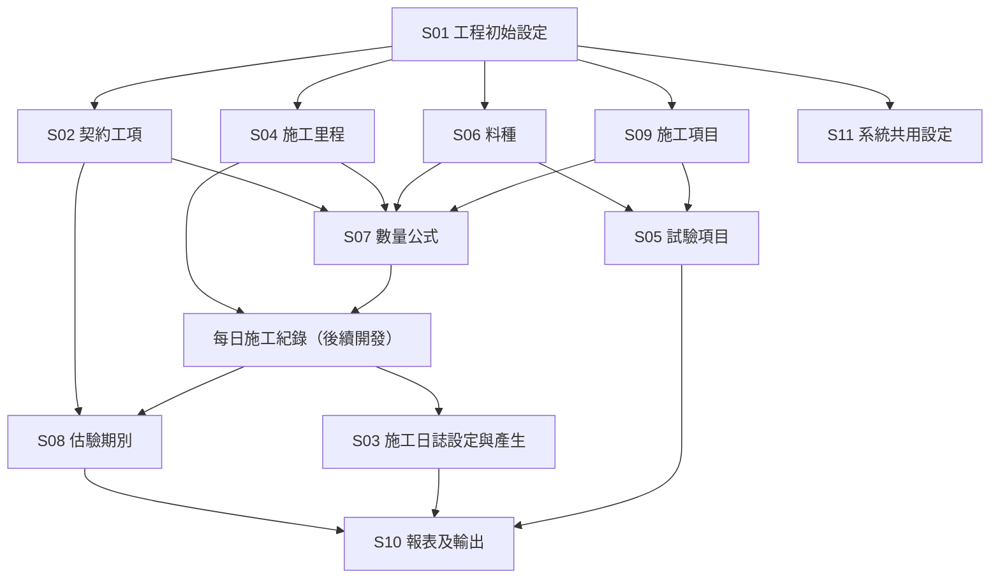

# 新工程管理系統｜初始設定與逐步開發備忘

- 建立日期：2026-11-23
- 適用專案：`NewEngineeringSystem`
- 文件狀態：需求基準 v1.0，逐項討論中
- 範圍：本文件記錄規劃，不代表功能均已實作
- 舊系統 `EngineeringQtySystem` / V3.0：僅作操作邏輯、欄位、數量公式的參考；**不直接套用舊資料庫、工程資料或未驗證的參數**。

## 一、共同原則

1. **全新開發**：建立新的程式及獨立 SQLite 資料庫；不修改舊系統。
2. **先規劃、逐項開發**：每次以一個模組為單位，依「需求討論 → 欄位確認 → 資料模型 → 畫面實作 → 儲存及計算測試 → 使用者確認 → Git Commit」推進。
3. **工程主檔為所有設定的起點**：能新增、儲存、查詢、編輯、切換工程，各工程資料與參數互不混用。
4. **資料分層**：契約設計數量、施工明細、施工日誌、試驗結果、估驗計價分別建模；相同施工事實只輸入一次，其餘以關聯方式引用。
5. **日期與里程一致**：畫面使用民國日期 `yyy/mm/dd`；資料庫使用標準日期；里程顯示 `000k+000`，依實際需求支援 50/100m 分段。
6. **公式須可追溯**：單位、係數、小數位數、四捨五入次序、版本及適用工程都需明確；歷史計算值不可因後續修改設定而靜默更動。
7. **資料安全**：工程實際紀錄、客戶資料、帳密與本機資料庫不提交至原始碼儲存庫；進行備份與修改歷程管理。
8. **記錄決策與問題**：未定案項目寫入待討論欄位；不得把建議值當作已確認的契約或工程規則。
9. **避免一次做完**：先把初始設定的完整架構規劃好，依優先順序逐項實作、測試與確認，不因有備忘就視為已完成。

## 二、初始設定模組清單

| 編號 | 設定模組 | 應研究的內容 | 目前狀態 |
|---|---|---|---|
| S01 | 工程初始設定 | 工程名稱、工程代碼、契約編號、主辦機關、監造、承包商、位置與範圍、契約金額、開工日期、預定完工日期、實際竣工日期、工程狀態 | V0.1/V0.2 已有雛形；新版本待實機驗收 |
| S02 | 契約工項設定 | 項次、工項代碼、名稱、規格、單位、契約數量、單價、複價、契約變更、施工實績對照 | 待討論 |
| S03 | 施工日誌設定 | 日誌欄位、施工日期、天候、當日工作、人員機具、停工情形、日誌格式、從施工明細帶入數量 | 待討論 |
| S04 | 施工里程設定 | 國道／路段、方向、車道、里程區間、各車道寬度、匝道與特殊區段、50/100m 分段、面積計算基礎 | 待討論 |
| S05 | 試驗項目設定 | 試驗名稱、適用工項與料種、檢驗頻率、規範值、取樣與試驗報告、判定與缺失追蹤 | 待討論 |
| S06 | 料種設定 | 材料代碼、名稱、類型、單位、密度、啟用狀態；DGAC／OGAC／PAC 為舊系統案例，實際各工程料種待確認 | 待討論 |
| S07 | 數量公式設定 | 長度／面積、刨除深度級距、噸數、回收率、運費、鋪設厚度、黏層、精度與四捨五入、公式版本 | 待討論 |
| S08 | 估驗期別設定 | 第幾期、起訖日、截算日、當期／累計量、已估驗資料鎖定、更正處理 | 待討論 |
| S09 | 施工項目設定 | 可選作業種類：刨除、鋪築、黏層、標線、貓眼、片型標記、線圈；每種項目的輸入欄位與計量單位 | 待討論 |
| S10 | 報表及輸出設定 | 施工日誌、每日數量、月報、契約與估驗查驗的 Excel/PDF 範本、欄位映射、輸出規則 | 待討論 |
| S11 | 系統共用設定 | 使用者與權限、備份與復原、異動稽核、匯入匯出、日期／數字格式、資料檢核 | 待討論 |

## 三、舊系統已討論過、可供檢討的細節（**尚非新系統定案**）

- 批次以施工日期及流水號識別；召回修改時要明確區分「更新原批次」與「建立新批次」。
- 里程可能包含 `國1／國3`、`N／S`、`1／2／3／4／外／匝` 等車道標記；不能在未核實的路段上假設車道寬度。
- 面積、深度及材料噸數須分清理論量與實際量；刨除、鋪築、回料、黏層及計價不能重複累計。
- 標線 1mm／2mm、貓眼、標記與線圈應可設定各自計量單位，不能強迫共用相同資料型別。
- 施工日誌應從已確認的每日施工紀錄產生，不應重新人工輸入已存在的施工數量。
- 契約數量與施工數量彼此獨立，依工項代碼／對照規則關聯；估驗不能只憑相似名稱推算。
- 試驗項目需有可維護的完整清單、判定標準與對應材料；不同試驗不能套用同一個檢驗規則。
- 可參考舊系統數量小數三位計算、兩位顯示等需求，但新系統仍須逐條確認計算精度及「先四捨五入、再加總」適用範圍。
- 新工程可以以「116年大甲段轄區維護工程」當成測試範例名稱，但**不得將舊工程資料直接匯入或當作預設真值**。

## 四、模組依賴與建議開發順序

此圖是**建議依賴關係**，不是已完成程式流程；次序可依使用者討論調整。初始設定完成後才進一步規劃施工資料操作與報表產生。

## 五、當前開發任務：S01 工程初始設定

先確認：
- 欄位是否齊全，必填／選填、欄位檢核是否合理。
- 工程代碼與契約編號分開管理。
- 工程建立、儲存、修改、載入、切換、重新啟動後讀回是否正確。
- 多工程間是否完全資料隔離。
- 民國日期顯示與日期邏輯（開工、預定完工、實際竣工）是否正確。

**S01 驗收之前，不將 S02–S11 當作已完成的運算功能。**

## 六、討論／開發追蹤表

| 日期 | 編號 | 決策／問題 | 狀態 | Commit |
|---|---|---|---|---|
| 2026-11-23 | 全系統 | 全新開發、不使用舊資料庫、保留舊系統合理邏輯供參考 | 已確認 | 本文件提交 |
| 2026-11-23 | S01–S11 | 先建立開發備忘區，逐項規劃、實作、驗收 | 已確認 | 本文件提交 |
| 2026-11-23 | S01 | 工程初始設定已有早期雛形，尚須確認欄位與操作 | 待驗證 | — |

## 七、每項模組的驗收模板

- **模組編號與名稱：**
- **使用者確認需求：**
- **輸入欄位及型別：**
- **必填值／預設值與來源：**
- **資料表及工程關聯：**
- **計算公式、單位與精度：**
- **操作流程：**
- **測試案例與結果：**
- **待修正問題：**
- **版本與 Git Commit：**

> 今後的討論與修改以此文件為「可追溯備忘」，逐項增補，不直接改寫或刪除既有決策紀錄。
