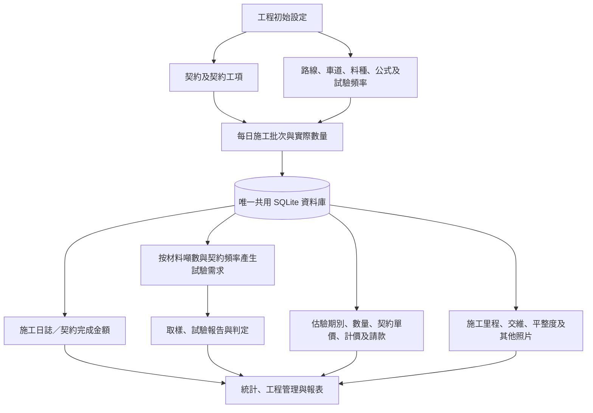
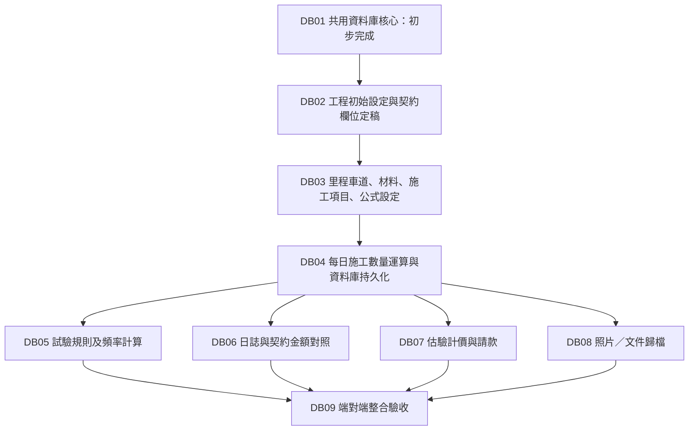

# 共用工程資料庫架構｜V0.1.0

**2026-11-23 建立**。此文件是全新工程管理系統的資料庫設計與測試紀錄。**舊 EngineeringQtySystem V3.0 資料庫不得套用或匯入**。資料庫已在獨立開發套件中建立並完成初步整合測試；GitHub 此文件記錄架構，完整 SQL/初始化程式/空白 SQLite 檔尚需另行同步至儲存庫，不應把此文件當成 GitHub 上已有全部原始碼的證明。

## 全系統要達成的工作流程

**施工的原始數量只記錄一次**；施工日誌、估驗、試驗、報表都依工程 ID、批次 ID、操作 ID 與契約工項 ID 引用同一來源，避免資料重複及數量歧異。

## 已建立的 31 張資料表（本地開發套件 V0.1.0）

| 系統分區 | SQLite 資料表 |
|---|---|
| 工程主檔／設定 | `projects`, `project_preferences`, `project_config_versions` |
| 契約與版次 | `contract_revisions`, `contract_items` |
| 里程、車道與施工範圍 | `road_routes`, `road_segments` |
| 材料與施工作業 | `material_types`, `work_types`, `work_contract_mappings` |
| 計算公式 | `calculation_rules` |
| 施工與實績 | `work_batches`, `work_operations`, `quantity_facts`, `quantity_contract_allocations` |
| 施工日誌 | `daily_logs`, `daily_log_batches` |
| 試驗管理 | `test_types`, `test_frequency_rules`, `test_requirements`, `test_samples`, `test_reports` |
| 估驗與請款 | `estimate_periods`, `estimate_lines`, `estimate_line_sources`, `estimate_adjustments`, `invoices` |
| 照片與文件 | `attachments`, `attachment_links` |
| 稽核／版本 | `audit_events`, `schema_migrations` |

## 關鍵業務定義

1. **一工程一資料歸屬**：單一 SQLite 資料庫管理多項工程，每項工程以 `project_id` 隔離。
2. **數量真實來源**：每筆施工記錄為 `work_batches → work_operations → quantity_facts`；保存面積、噸數等精度與來源。施工日誌不重建另一份原始數量。
3. **契約設計量與施工實績分離**：原契約及變更使用 `contract_revisions`／`contract_items`；實際數量透過 `quantity_contract_allocations` 與工項關聯，不因契約修改覆蓋歷史資料。
4. **估驗來源可追**：`estimate_line_sources` 記錄每期估驗引用的施工數量，`estimate_lines` 保存當期與累計數量及當時單價快照；已核准估驗資料禁止直接修改。初版以同一來源分配不得出現在多個未作廢估驗作防重複請款檢查。
5. **試驗由契約規則決定**：`test_frequency_rules` 可設定試驗種類、料種、施工種類、每若干噸一次、取整政策、適用日期及範圍。由 `quantity_facts` 中符合條件的鋪設噸數推算 `test_requirements`，再連到 `test_samples`／`test_reports`。**不得把測試範例頻率當成實際契約規定**。
6. **照片不塞進 SQLite**：`attachments` 儲存檔案路徑、類別、SHA-256 等資訊；`attachment_links` 可將照片關聯到施工批次、里程操作、日誌、試驗及估驗。照片原始檔另外備份。
7. **精度**：施工數量用十進位文字保存並以 Python Decimal 計算；計價金額採整數分保存；民國日期僅畫面轉換，資料庫使用 ISO 日期字串。
8. **工程設定可版本化**：工程主檔、路線車道、材料、公式、試驗規則不可因後續修改而讓已核准資料不明原因變動。
9. **尚需加強的檢查**：所有跨表同工程檢查、照片多型連結驗證、試驗跨日／累計頻率、估驗部分請款與修正、契約版次過渡、施工數量鎖定、完整異動稽核與交易回滾。

## 整合驗證（開發套件 V0.1.0）

- SQLite **31 張表**，`PRAGMA integrity_check` 回傳 `ok`；`foreign_key_check` 0 異常。
- 通過 **3 項自動整合測試**：空白 DB 初始化與重啟、多工程隔離、施工 → 日誌 → 試驗需求／報告 → 估驗來源 → 照片連結。
- 阻擋不同工程的施工項目寫進其他工程批次；阻擋同日誌引用不同工程或日期的批次。
- 阻擋同一施工數量分配在不同未作廢期別重複估驗；阻擋直接更新／刪除已核准估驗明細。
- **測試使用虛構數字，不含任何舊工程資料**。

## 後續工作順序

## 工程開發紀錄

| 日期 | 動作 | 結果 |
|---|---|---|
| 2026-11-23 | 新建一套統一 SQLite schema、初始化程式、十進位試驗頻率計算函式、測試及空白資料庫 | 31 張表；3 項測試通過；程式套件以獨立 ZIP 交付 |
| 2026-11-23 | 建立本 GitHub 架構紀錄 | 供後續逐項確認與修改；此提交不代表已同步全部程式檔 |

**下一步先確認 DB02 工程初始設定和契約關聯，再做每日施工數量運算，不先開發所有畫面。**
